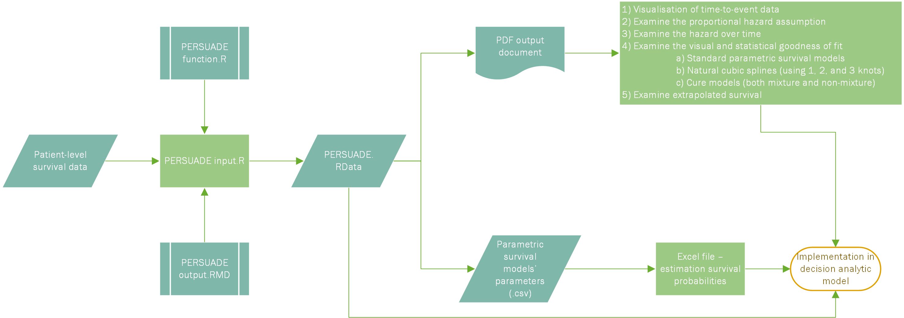

# PERSUADE

**ParamEtRic SUrvivAl moDel sElection**

A standardized R tool to support the selection, comparison, and
communication of parametric survival models, and their implementation in
decision-analytic models.

------------------------------------------------------------------------

## Overview

PERSUADE guides analysts through a reproducible workflow for survival
analysis and model selection. It provides:

- Kaplan-Meier visualizations and diagnostics
- 33 reviewed NSCLC pseudo-IPD datasets (see [example datasets](#nsclc-example-survival-datasets))
- Assessment of proportional hazards (PH) assumption
- Observed and predicted hazard function plots
- Fit comparisons of standard, spline-based, and cure models
- Goodness-of-fit statistics (AIC/BIC)
- Explore model extrapolation beyond observed data
- Automated PDF reports for communication
- Export the parametric survival model parameters for use in
  decision-analytic models

The framework is designed for transparency and consistency when survival
analysis feeds into decision-analytic models.

------------------------------------------------------------------------

## Prerequisites

- R (version compatible with survival and other dependencies)
- Recommended: RStudio for better environment handling
- Install PERSUADE package using `install.packages("PERSUADE")`
- Alternatively: to install the development version of PERSUADE:
  `devtools::install_github("Bram-R/PERSUADE", quiet = TRUE, upgrade = "never")`
- Load PERSUADE package: `library(PERSUADE)`

## Quick start

To get started, open `PERSUADE_example_workflow.R` and run its contents in R:
`file.edit(system.file("example_workflow", "PERSUADE_example_workflow.R", package = "PERSUADE"))`

This script:

- Loads example survival data.
- Runs the main PERSUADE analysis (`f_PERSUADE()`).
- Summarizes results with `print()`, `summary()`, and `plot()`.
- Generates a ready-to-share PDF report via `f_generate_report()`.
- Exports fitted model parameters to .csv.

------------------------------------------------------------------------

## NSCLC example survival datasets

PERSUADE includes **33 reviewed trial-population datasets** of reconstructed
pseudo-individual patient data (pseudo-IPD) for overall survival in advanced
non-small cell lung cancer (NSCLC), covering EGFR-targeted therapies,
ALK-targeted therapies, and immunotherapies. The collection contains 11,572
reconstructed records across 66 treatment arms.

- [`?nsclc_ipd`](man/nsclc_ipd.Rd): survival records, PICO descriptions,
  reconstructed sample sizes and event proportions, and trial-specific
  validation notes and limitations.
- [`?nsclc_trials`](man/nsclc_trials.Rd): trial and population metadata,
  treatment comparisons, references, and original publication links.

If your installed release does not include these datasets, install the
development version shown above.

```{r, eval=FALSE}
library(PERSUADE)
data("nsclc_ipd", package = "PERSUADE")
data("nsclc_trials", package = "PERSUADE")

# Discover comparisons and select one by its stable identifier
nsclc_trials[, c("dataset_id", "trial_id", "population")]
example_id <- "EGFR_Lux-Lung3"
example_ipd <- subset(nsclc_ipd, dataset_id == example_id)
example_trial <- subset(nsclc_trials, dataset_id == example_id)
example_trial[, c("population", "intervention_treatment", "control_treatment")]
```

Estimate and plot Kaplan-Meier survival by treatment arm (times are in months):

```{r, eval=FALSE}
km <- survival::survfit(
  survival::Surv(time_months, event) ~ arm,
  data = example_ipd
)
plot(km, col = c("#0072B2", "#D55E00"), lty = 1:2,
     xlab = "Time (months)", ylab = "Overall survival probability")
legend("topright", legend = sub("^arm=", "", names(km$strata)),
       col = c("#0072B2", "#D55E00"), lty = 1:2, bty = "n")

# Reconstructed sample sizes, deaths, and event fractions by arm
arm_summary <- aggregate(
  cbind(n = rep(1L, nrow(example_ipd)), events = example_ipd$event),
  by = list(arm = example_ipd$arm),
  FUN = sum
)
arm_summary$event_fraction <- with(arm_summary, events / n)
arm_summary
```

Use `dataset_id` to find the source publication without relying on row order:

```{r, eval=FALSE}
example_trial[, c("trial_publication", "trial_url")]
trial_url <- example_trial$trial_url[1L]
if (interactive() && !is.na(trial_url) && nzchar(trial_url)) {
  utils::browseURL(trial_url)
}
```

To use this example in the workflow below, supply
`years = example_ipd$time_months / 12`, `status = example_ipd$event`, and
`group = example_ipd$arm`; keep the prediction horizon and time points in years.

These are reconstructed observations, not original patient records.
All 33 datasets were reviewed against published aggregate survival results;
see `?nsclc_ipd` for known discrepancies. Event fractions describe reconstructed
deaths and do not directly measure follow-up maturity or tail precision.
Some trial populations overlap and must not be pooled as independent cohorts.
When reusing the data, cite the original trial publications, Simons et al.
(2020), and Guyot et al. (2012), as listed in the help pages.
The digitized source archive is available on
[Zenodo](https://doi.org/10.5281/zenodo.4288605) under CC BY 4.0.

------------------------------------------------------------------------

## Step-by-step workflow

### 1. Load PERSUADE package

```{r, eval=FALSE}
library(PERSUADE)
```

### 2. Run example analysis

```{r, eval=FALSE}
PERSUADE <- f_PERSUADE(
  name = "BC_OS",
  years = flexsurv::bc$recyrs,   # time-to-event
  status = flexsurv::bc$censrec, # event indicator
  group = flexsurv::bc$group,    # grouping variable
  strata = TRUE,
  spline_mod = TRUE,
  cure_mod = TRUE,
  time_unit = 1/12,              # months in years
  time_horizon = 40,
  time_pred_surv_table = c(0, 1, 2, 5, 10, 20, 30, 40)
)
```

### 3. Inspect the object

```{r, eval=FALSE}
print(PERSUADE)
```

### 4. Summarize results

```{r, eval=FALSE}
# Kaplan-Meier estimates
summary(PERSUADE, type = "km")

# Survival probabilities at time points
summary(PERSUADE, type = "surv_probs")

# Goodness-of-fit for standard parametric models
summary(PERSUADE, type = "gof")

# Goodness-of-fit for spline-based models
summary(PERSUADE, type = "gof_spline")

# Goodness-of-fit for cure models
summary(PERSUADE, type = "gof_cure")
```

### 5. Visualize results

```{r, eval=FALSE}
# Set colour palette for Figures
palette(rainbow(n = 9, s = 1, v = 1, start = 0, end = max(1, 9 - 1)/9, alpha = 1)) 

# Kaplan-Meier curves
plot(PERSUADE, type = "km")

# Proportional hazards diagnostics
plot(PERSUADE, type = "ph")

# Observed smoothed hazard
plot(PERSUADE, type = "hr")

# Standard parametric models
plot(PERSUADE, type = "param_models")

# Spline-based models
plot(PERSUADE, type = "spline_models")

# Cure models
plot(PERSUADE, type = "cure_models")

# Set colour palette to default
palette("default") 
```

### 6. Generate the report

```{r, eval=FALSE}
f_generate_report(PERSUADE)
```

### 7. Export model parameters

```{r, eval=FALSE}
# Copy to the Windows clipboard (for the PERSUADE Excel template)
if (.Platform$OS.type == "windows") {
  write.table(PERSUADE$surv_model_excel, "clipboard-128",
              sep = "\t", col.names = FALSE)
}

# Export to CSV (use getwd() instead of tempdir() for persistent files)
output_dir <- file.path(tempdir(), paste0(PERSUADE$name, "_output"))
dir.create(output_dir, recursive = TRUE, showWarnings = FALSE)
write.csv(PERSUADE$surv_model_excel,
          file.path(output_dir,
                    "PERSUADE_Time-to-event_models_parameters_comma.csv"))
write.csv2(PERSUADE$surv_model_excel,
           file.path(output_dir,
                     "PERSUADE_Time-to-event_models_parameters_semicolon.csv"))
```

### 8. Obtain Excel template to incorporate model parameters in decision-analytic model

```{r, eval=FALSE}
f_get_excel_template()
```

------------------------------------------------------------------------

## Workflow diagram

Visualize the process via the included diagram:  


*(Alternatively, open the `.vsdx` version if preferred.)*

------------------------------------------------------------------------

### Tips for running your own analyses

Start by running the example script to familiarize yourself with the
workflow. For your own data:

- open `PERSUADE_example_workflow.R` using:
  `file.edit(system.file("example_workflow", "PERSUADE_example_workflow.R", package = "PERSUADE"))`;
  save a copy in a writable working folder before editing it;
  see also vignette using: `browseVignettes("PERSUADE")`
- replace the input section with your dataset
- set the project name and outcome identifier using the `name`
  parameter  
- within the call to `f_PERSUADE(...)`, toggle options (`TRUE`/`FALSE`)
  for the analyses you want to run

------------------------------------------------------------------------

## Extending or customizing

- Add new model types: incorporate additional parametric distributions
  or non-parametric methods by extending `f_PERSUADE()`.  
- Refine plots: customize visualizations in
  `PERSUADE_output_functions.R` or adopt themes for publication-quality
  graphics.  
- Automate Reporting: enhance the ‘rmarkdown’ template for
  production-ready reports.

------------------------------------------------------------------------

## Acknowledgments & history

- Origins: this repository represents an ongoing effort to standardize
  survival model workflows in decision analysis.  
- Contributors: developed by **Bram-R**
  (<https://orcid.org/0000-0001-5785-9228>) and **Xa4P**
  (<https://orcid.org/0000-0003-3563-0013>); contributions are welcome
  via pull requests or issues.

------------------------------------------------------------------------

## License & contact

Licensed under
[**GPL3**](https://github.com/Bram-R/PERSUADE/tree/master?tab=GPL-3.0-1-ov-file#readme).  
For questions, enhancements, or collaboration, reach out via GitHub
discussions or issues.
